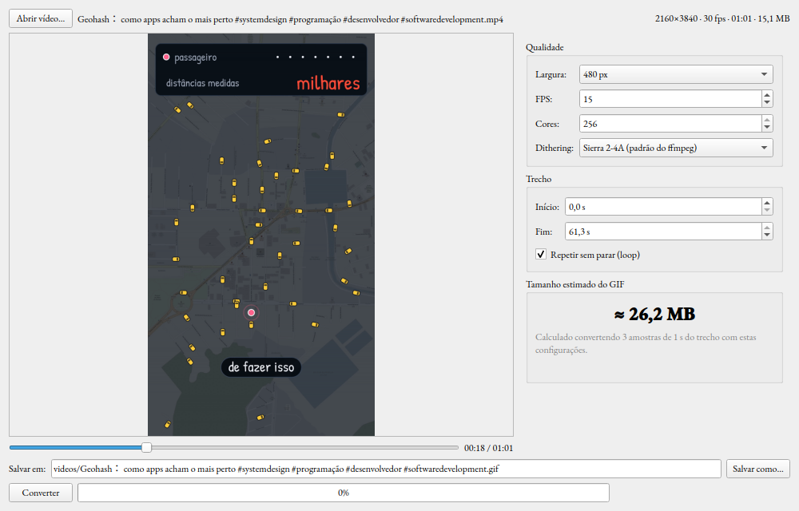

# Ferramentas para profissionais nada complicadas

Coleção de scripts em Python para automatizar a produção de vídeo e algumas
tarefas do dia a dia, rodando **100% na máquina local**: transcrição, plano de
cortes, descrição e thumbnail com IA local (Whisper, Ollama, SD-Turbo), além de
conversores e utilitários.

Cada script é independente e sem instalação: roda com `python3 script.py`,
cria o próprio ambiente virtual temporário quando precisa de bibliotecas e o
apaga ao terminar. Nada fica instalado no sistema além de `python3`, `ffmpeg`
e o que cada ferramenta pede explicitamente.

## Estrutura

```
convert/                    Vídeo → GIF, com interface gráfica e por linha de comando
download/                   Download de vídeos pelo título (yt-dlp)
transcricao/                Transcrição local de áudio e vídeo (faster-whisper)
youtube/                    Pipeline de pós-produção com IA local: cortes, descrição e thumbnail
receptor_saude_kdeconnect/  Recebe e organiza dados de saúde do celular via KDE Connect
```

## Ferramentas

### `convert/mp4_to_gif.py` — vídeo para GIF com interface gráfica



Interface em PyQt6 sobre o ffmpeg para transformar vídeo em GIF com controle
fino de qualidade e tamanho.

- Pré-visualização do quadro na posição escolhida, **já com a largura, as cores
  e o dithering aplicados** (mesma paleta que o GIF final vai usar).
- Qualidade: largura (original ou presets), FPS, quantidade de cores (2 a 256)
  e dithering (Sierra 2-4A, Floyd-Steinberg, Bayer ou nenhum).
- Trecho (início/fim) e loop.
- **Estimativa do tamanho final** recalculada a cada ajuste: converte três
  amostras de 1 s do trecho, lê no GIF o tamanho do primeiro quadro (cheio) e
  dos seguintes (só a diferença) e extrapola para o total de quadros. Erro
  medido entre −1 % e +8 % em relação ao arquivo real.
- Conversão com barra de progresso real e cancelamento.

```bash
python3 convert/mp4_to_gif.py            # abre a janela
python3 convert/mp4_to_gif.py video.mp4  # já abre com o vídeo carregado
```

Requer: `ffmpeg` e PyQt6 (`sudo apt install ffmpeg python3-pyqt6`).

### `convert/video_para_gif.py` — vídeo para GIF por linha de comando

Mesma conversão com paleta otimizada, sem interface, para usar em scripts.

```bash
python3 convert/video_para_gif.py VIDEO
python3 convert/video_para_gif.py VIDEO -o saida.gif --fps 12 --largura 640
python3 convert/video_para_gif.py VIDEO --inicio 5 --duracao 10 --sem-loop
```

Requer: `ffmpeg`.

### `download/baixar_vid.py` — download de vídeos pelo título

Baixa vídeos com yt-dlp salvando cada um com o título como nome de arquivo.
Feito para o Pornhub, que exige impersonação de navegador (`curl_cffi`);
aceita cookies do navegador, limite de resolução e, opcionalmente, roteia
tudo pela rede Tor (reaproveita um Tor já ativo ou sobe um processo próprio e
o encerra no final).

```bash
python3 download/baixar_vid.py URL [URL ...]
python3 download/baixar_vid.py -o pasta_destino -q 720 URL
python3 download/baixar_vid.py -f lista.txt   # uma URL por linha
```

Requer: `ffmpeg`; `tor` só se escolher usar a rede Tor.

### `transcricao/transcrever.py` — transcrição local

Transcreve áudio ou vídeo com faster-whisper sem enviar nada para a internet.
Vídeos têm o áudio extraído com ffmpeg antes; a saída pode ser `txt`, `srt` ou
`vtt`. Usa GPU (CUDA) quando disponível e cai para CPU automaticamente.

```bash
python3 transcricao/transcrever.py ARQUIVO
python3 transcricao/transcrever.py ARQUIVO -m medium -l pt
python3 transcricao/transcrever.py ARQUIVO -o legendas.srt --formato srt
```

Requer: `ffmpeg`.

### `youtube/` — pipeline de pós-produção com IA local

Três scripts encadeados que preparam um vídeo bruto para edição no Filmcraft e
geram os materiais de publicação, tudo com modelos rodando localmente
(faster-whisper, Ollama, SD-Turbo). A pasta do projeto fica em
`~/Vídeos/Projetos/<nome>/` e cada etapa salva o próprio resultado nela.

1. **`editar_video.py VIDEO`** — transcreve o vídeo, pede a um LLM local
   (Ollama) um plano de edição no estilo do canal (jump cuts, zooms, legendas,
   efeitos sonoros e trilha) e gera `projeto.fcproj` com os cortes já montados
   na timeline do Filmcraft, a partir de um modelo de projeto otimizado.
   Salva `transcricao.json`, `plano_edicao.json`, `legendas.srt` e
   `notas_edicao.txt`. Nada é renderizado: a decisão final fica com o editor.
2. **`gerar_descricao.py PASTA_DO_PROJETO`** — escreve a descrição do YouTube
   (parágrafo, hashtags e capítulos com os tempos recalculados para a timeline
   já cortada) em `descricao.txt`. Só biblioteca padrão.
3. **`gerar_thumbnail.py PASTA_DO_PROJETO`** — gera a thumbnail 1280×720 com
   fundo criado por SD-Turbo na GPU e o personagem fixo do canal recortado
   (`rembg`). Pergunta título, estilo e frase de impacto, ou recebe tudo pronto
   via `--contexto contexto.json` para rodar sem interação.

```bash
python3 youtube/editar_video.py video.mp4 --whisper medium --llm gemma4:12b
python3 youtube/gerar_descricao.py ~/Vídeos/Projetos/meu-video
python3 youtube/gerar_thumbnail.py ~/Vídeos/Projetos/meu-video
```

Requer: `ffmpeg`, Ollama rodando em `localhost:11434`; GPU NVIDIA para a
thumbnail; `xdotool`/`wmctrl` opcionais para abrir o projeto no Filmcraft.

### `receptor_saude_kdeconnect/receptor.py` — dados de saúde via KDE Connect

Fica aguardando o celular aparecer na rede (`kdeconnect-cli`) e, quando o app
do relógio exporta arquivos `.json`/`.csv` para a pasta de Downloads via
compartilhamento do KDE Connect, copia e organiza tudo em `dados_recebidos/`
com data e hora.

```bash
python3 receptor_saude_kdeconnect/receptor.py
```

Requer: KDE Connect pareado com o celular.

## Como os scripts lidam com dependências

Scripts que precisam de bibliotecas externas criam um ambiente virtual
temporário (`.env/` ao lado do script), instalam o necessário, executam e
apagam o ambiente ao final, mesmo em caso de erro. Isso mantém o sistema
limpo e evita conflitos entre versões. Scripts que só usam a biblioteca
padrão (ou pacotes do sistema, como o PyQt6) rodam direto.

## Requisitos gerais

- Linux com Python 3.10+ e `python3-venv`
- `ffmpeg` e `ffprobe`
- Requisitos específicos listados em cada ferramenta acima

## Autor

Pedro Henrique Netto dos Santos — criador do canal Mister Netto, para o qual
o pipeline de pós-produção foi desenhado.
